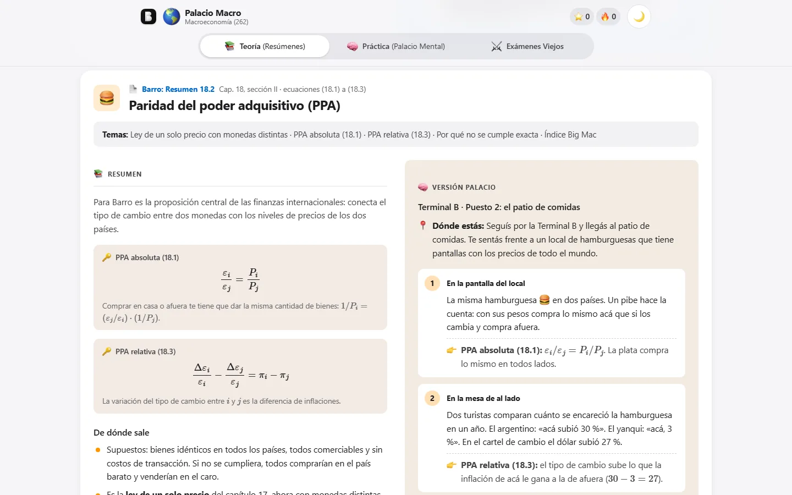

# Palacio Macro · Macroeconomía (262)

Página de estudio para el **tercer parcial de Macroeconomía (262)** de la Facultad de Ciencias Económicas de la UBA (Sede Córdoba, cátedra Rodriguez Repeti, 2.º cuatrimestre de 2026). Resume toda la bibliografía del parcial sobre **economía abierta**: mercados mundiales de bienes y crédito, tipos de cambio, el modelo Mundell-Fleming y la elección del régimen cambiario.

**👉 Abrir la página: https://matiasbellidor.github.io/3PMAC_2C2026/**

## Para qué sirve

Junta en un solo lugar las tres cosas que hacen falta antes de un parcial: entender la teoría, memorizar las ecuaciones y practicar con preguntas. Funciona en la compu y en el celular, sin crear una cuenta ni instalar nada.

## Qué tiene

### 📚 Teoría (Resúmenes)
33 resúmenes ordenados por fuente. Cada uno dice de qué texto sale y qué temas cubre (por ejemplo, «Barro: Resumen 17.1 · Temas: …»), resalta las ecuaciones clave y tiene dos versiones, una al lado de la otra: el **resumen normal** y su **versión palacio**, para estudiar el mismo tema de las dos maneras.

**¿Poco tiempo?** Al final de cada fuente hay dos botones: **Leer la historia completa** (los 33 resúmenes con su palacio en una sola página, con un índice de capítulos) y **Escuchar la historia**, que la lee en voz alta como un audiolibro, con velocidad de ×0,5 a ×1,5 (más rápido no se entiende), que recuerda dónde quedaste y que se corta sola apenas salís de la historia (por ejemplo, al volver al inicio). La voz es la del dispositivo y no se elige: usa sola la argentina si la tiene (Edge, iPhone y iPad) y, si no, la de español más natural que encuentre.

| Fuente | Resúmenes | Temas |
|---|---|---|
| Barro, *Macroeconomics: A Modern Approach*, cap. 17 | 7 | Ley de un solo precio, restricción presupuestaria, balanza de pagos, ahorro e inversión, historia de la cuenta corriente de EE.UU., ciclos reales, déficits gemelos y términos del intercambio |
| Barro, cap. 18 | 5 | Tipo de cambio, paridad del poder adquisitivo, paridad de tasas, tipo de cambio fijo y flexible |
| Blanchard, *Macroeconomía*, caps. 17 a 20 | 8 | Tipo de cambio real, balanza de pagos, paridad de intereses, la IS abierta, curva J, Mundell-Fleming, crisis cambiarias y elección del régimen |
| Sachs y Larraín, *Macroeconomía en la economía global*, cap. 9 | 4 | Demanda agregada abierta, políticas con tipo fijo y flexible (tabla 9.1), evidencia y el euro |
| Mundell (1963) | 2 | Movilidad perfecta del capital y estabilización con tipo fijo y flexible |
| Fleming (1962) | 2 | Política fiscal y monetaria según el régimen cambiario |
| Obstfeld y Rogoff (1995) | 3 | «The Mirage of Fixed Exchange Rates»: costos, ataques especulativos y alternativas |
| Apuntes de la cursada, clase 14 de 19 | 2 | Agregados monetarios, activos y pasivos del BCRA, del Tesoro y del sector privado (con sus tablas), y balanza de pagos: cuenta corriente, cuenta capital y financiera, y CC + CKF = 0 |

### 🧠 Práctica (Palacio Mental)
Un **palacio de la memoria** armado sobre el aeropuerto de Ezeiza: hall, check-in, Migraciones, sala de embarque y pista, siempre en el mismo orden. Cada lugar guarda un tema con una escena exagerada, escrita en castellano rioplatense, donde cada objeto dice qué concepto representa. Los demás PDF tienen sus propias terminales y salas del aeropuerto dentro de los resúmenes.

Son cinco habitaciones con 22 preguntas sobre el capítulo 17 de Barro, de opción múltiple y con cuentas. Si acertás, avanzás. Si errás, ves la explicación paso a paso contada con la historia del palacio, y la pregunta vuelve al final. Cada habitación superada abre la siguiente.

### ⚔️ Jefes (Estilo parcial)
Tres jefes con 19 preguntas de opción múltiple estilo parcial. Cada acierto le saca vida al jefe y cada error te cuesta un corazón; con tres errores perdés la pelea. Al terminar, ves las preguntas que fallaste con su respuesta y los resúmenes para repasar.

### 📝 Simulacros (Temas A–D)
Cuatro simulacros del parcial, cada uno con 21 preguntas de opción múltiple (a, b, c, d) sobre todo el temario, con el mismo criterio de corrección del parcial:
- Cada correcta suma 100/21 (≈ 4,76).
- Cada incorrecta resta 100/63 (≈ 1,59).
- Las que quedan en blanco no suman ni restan.
- Se aprueba con 50.

El resultado se ve al entregar, con la explicación de cada pregunta y el resumen para repasar. Se guarda tu mejor nota en cada tema, hay un mensaje según el porcentaje y, si superás el 70 % en los cuatro temas, festejo.

### ✅ Temas para tildar
En el costado derecho de la página hay una pestaña **Temas** (con el avance, por ejemplo «12/144»). Al tocarla se abre un panel con los 31 temas y los 144 subtemas que entran, agrupados por PDF, para ir tildando lo que ya dominás:
- Tildar un subtema suma al avance; tildar un tema tilda todos sus subtemas de una, y un tema con subtemas a medias queda marcado con una rayita.
- Cada tema tiene su link **Ver el resumen**. En la compu el panel queda al lado de la página, así que podés leer y tildar a la vez; en el celular se abre como un diálogo.
- El Anexo (clase 14) no está en la lista porque es material extra, por fuera de la cátedra.
- Lo que tildaste se guarda solo en tu navegador y se borra con «Borrar mi progreso». La pestaña no aparece durante un simulacro.

### Además
- Puntos de experiencia y racha de respuestas correctas.
- El progreso (incluidas tus mejores notas de los simulacros y los temas que tildaste) se guarda solo en tu navegador. No hay cuentas, cookies ni analítica, y lo podés borrar desde el pie de la página.
- Tema claro y oscuro.
- Se puede usar con el teclado: las teclas 1 a 4 eligen una opción y Enter confirma.

## Hacé tu propia versión

Si querés cambiar los resúmenes, sumar preguntas o adaptarla a otra materia, podés tener tu copia publicada desde tu cuenta de GitHub, gratis:

1. Tocá **Fork**, arriba a la derecha de este repositorio, para crear una copia en tu cuenta. También podés clonarlo con el botón **Code** (por ejemplo, con GitHub Desktop).
2. En tu copia, entrá a **Settings → Pages**, elegí **Deploy from a branch**, la rama **`main`** y la carpeta **`/ (root)`**, y guardá.
3. En uno o dos minutos tu versión queda publicada en `https://<tu-usuario>.github.io/3PMAC_2C2026/`. Cada cambio que subas a `main` se publica solo.

Es un sitio estático, así que también funciona en otros servicios de hosting como Vercel o Netlify: importás el repositorio y lo publicás sin configurar nada.

## Fuentes y aviso

- Bibliografía: Barro, *Macroeconomics: A Modern Approach* (caps. 17 y 18); Blanchard, *Macroeconomía* (7.ª ed., caps. 17 a 20); Sachs y Larraín, *Macroeconomía en la economía global* (cap. 9); Mundell, «Capital Mobility and Stabilization Policy under Fixed and Flexible Exchange Rates» (1963); Fleming, «Domestic Financial Policies under Fixed and under Floating Exchange Rates» (1962), y Obstfeld y Rogoff, «The Mirage of Fixed Exchange Rates» (1995). Los PDF no están en el repositorio porque tienen derechos de autor.
- Los resúmenes, las historias del palacio y las preguntas son material propio de estudio.
- Este no es un sitio oficial de la Universidad de Buenos Aires ni de la cátedra. El sello de la UBA (dominio público) y el escudo de la Facultad de Ciencias Económicas solo identifican la institución donde se cursa la materia.
- Emojis designed by Apple. Used for educational purposes. LinkedIn, Gmail, Outlook y GitHub son marcas de sus respectivos dueños.

## Autor

Creado por **Matías Rodrigo Bellido**, estudiante de Ciencias Actuariales en la FCE-UBA. [Conectá conmigo en LinkedIn](https://www.linkedin.com/in/matiasbellido/) o escribime tus consultas a rbellidomatias@gmail.com.

© 2026 Matías Rodrigo Bellido. Todos los derechos reservados.
